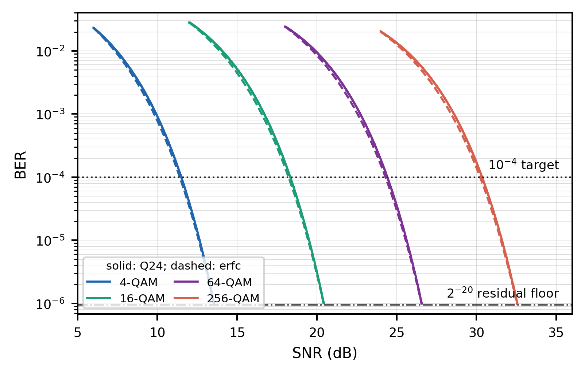

A Low-Complexity Bit-Loading Engine with Conservative Bit-Error-Rate Estimation for Bidirectional Discrete Multitone Wireline Transceivers

Author A, Author B and Supervisor C

1 School of Electronics and Information Engineering, Korea Aerospace University, Goyang, Republic of Korea

Email: \[corresponding author institutional email\]

*Running title:* Conservative Bit-Loading Engine

To exploit frequency-selective loss in high-speed wireline links, this letter presents an on-physical-layer (PHY) bit-error-rate (BER)-aware bit-loading engine that generates per-tone quadrature-amplitude-modulation (QAM) allocations from a signal-to-noise-ratio (SNR) profile during discrete multitone (DMT) training or retraining. The QAM-specific coefficient search accounts for Q16/Q24 register-transfer-level quantisation and truncation and prevents the fixed-point estimator from falling below the adopted erfc-based BER reference over the design SNR ranges. The engine uses a 32-entry exponential look-up table, Q24 BER arithmetic, transmitted-bit-weighted aggregation, divider-free group comparison, and per-QAM margin refinement. Across two channel profiles, its net-rate loss relative to the erfc-based dynamic-programming reference is at most 2.08%, and full-precision reevaluation of the final allocations using the adopted BER expression confirms that both satisfy the 10⁻⁴ target. Under an identical implementation flow, the proposed engine reduces total cell area by 41.0% and total power by 26.6% relative to an unbiased piecewise-Chebyshev RTL baseline; both complete allocation within 1 ms at 100 MHz.

*Keywords:* adaptive bit loading; bit-error-rate estimation; discrete multitone; fixed-point arithmetic; look-up table; wireline transceiver

*Introduction:* As data rates increase, high-speed chip-to-chip and backplane wireline links experience greater high-frequency channel loss and equalisation burden. Because pulse-amplitude-modulation formats carry a fixed number of bits per symbol, they cannot efficiently exploit the SNR distribution across channels with strong frequency selectivity or deep notches. Discrete multitone instead divides the wideband channel into many subcarriers and independently adjusts the QAM order of each tone, making it well suited to frequency-selective channels \[1\].

Although bit loading is well established, executing it rapidly in a compact PHY-internal digital controller during training or retraining presents a distinct implementation challenge. BER-informed bit/power-profile adjustment has improved performance by exploiting the subchannel error distribution, but prior work performed waveform generation, received-data processing, and profile calculation in MATLAB \[2\]. This work targets a synthesizable on-PHY engine that generates a new QAM map within hundreds of microseconds after an SNR profile becomes available, rather than continuous adaptation during normal data transmission.

Under the application condition that the two directions of a matched link exhibit sufficiently similar channel quality, we consider a local-RX-to-local-TX architecture. RX-A uses the measured B-to-A SNR profile to compute the A-to-B map for local TX-A, and the opposite endpoint operates identically. A related concept has been reported for visible-light-communication rate selection using identical hardware at both endpoints \[3\]. This condition does not imply general reciprocity for all wireline links. The resulting architecture is shown in Fig. 1.

Fig. 1 Proposed local-RX-to-local-TX bidirectional discrete multitone architecture and conservative-Q24 on-PHY bit-loading engine. The erfc-based DP oracle is used only as an offline reference and is not included in the RTL datapath.

*Proposed engine:* The evaluation system uses a 20 Gsample/s sampling rate, a 512-point FFT/IFFT, a 40-sample cyclic prefix, 255 active positive-frequency tones, and 4/16/64/256-QAM. The engine receives Q16 per-tone SNRs obtained during training or retraining; the base thresholds for 4-, 16-, 64-, and 256-QAM are 6, 12, 18, and 24 dB, respectively. The performance reference is an offline dynamic-programming (DP) oracle that evaluates the adopted erfc-based BER expression using the same Q16 SNRs and candidate set {unused, 4-QAM, 16-QAM, 64-QAM, 256-QAM} to maximise the total loaded bits subject to a transmitted-bit-weighted BER of at most 10⁻⁴. We adopt the standard high-SNR BER approximation for Gray-coded square M-QAM \[4\]:

$P_{b}^{ref}(M,\gamma) = \frac{2}{\log_{2}M}\left( 1 - \frac{1}{\sqrt{M}} \right)erfc\left( \sqrt{\frac{3\gamma}{2(M - 1)}} \right)$ (1)

where erfc(·) is the complementary error function, M is the QAM order, and γ is the linear per-tone SNR. Instead of evaluating (1) directly, the engine implements the base-2 exponential form in (2) using fixed-point arithmetic.

${\widehat{P}}_{b}(M,\gamma) = C_{M}2^{- K_{M}\gamma}$ (2)

*KM*, *CM*, and the SNR are quantised in Q16. The five fractional bits of Y=*KM*γ address a 32-entry Q16 look-up table, while the integer part provides the shift amount. The *CM*×LUT product forms a Q24 BER base, which is right-shifted by the integer part of Y to obtain the final per-tone BER. Registers R1-R3 align the tier, SNR, carrier index, and valid signal at each stage, allowing one tone to be accepted per clock after pipeline filling. *KM* and *CM* are selected such that the one-sided condition in (3) holds over the QAM-specific domain *DM*, which extends from each base threshold to the point at which the reference BER reaches 2⁻²⁰.

${\widehat{P}}_{b}^{Q24}(M,\gamma) \geq P_{b}^{ref}(M,\gamma),\quad\quad\gamma \in \mathcal{D}_{M}$ (3)

During coefficient generation, all 65,536 unsigned Q16 candidates for K are examined for each QAM order. For every K, the minimum C satisfying (3) is found, and the pair that minimises the worst-case estimator-to-reference-BER ratio is selected. In the order \[4-QAM, 16-QAM, 64-QAM, 256-QAM\], the resulting Q16 coefficients are K=\[50734, 10213, 2436, 602\] and C=\[12756, 10206, 8057, 6506\]. For example, the Q24 estimator-to-reference-BER ratio over the 64-QAM verification domain ranges from 1.00005 to 1.23031, with no underestimation. For very high γ, where the full-precision reference BER is below 2⁻²⁰ and the Q24 result may quantise to zero, a global residual guard is used instead of unnecessarily increasing the coefficients.

Because the QAM orders carry different numbers of bits per tone, the controller evaluates link BER using a transmitted-bit-weighted average rather than a simple tone average.

$P_{b,total} = \frac{\sum_{k}^{}b_{k}P_{b,k}}{\sum_{k}^{}b_{k}}$ (4)

The target is *Pb,target*=10⁻⁴. To reserve the maximum possible missing contribution, 2⁻²⁰, from the low-BER quantisation tail, the runtime acceptance threshold is defined by (5). The RTL avoids division by comparing the weighted-error sum with the guarded target multiplied by the total number of loaded bits through cross multiplication.

${\widehat{P}}_{b,total} \leq P_{b,target} - 2^{- 20} = 9.90463 \times 10^{- 5}$ (5)

The engine FSM executes scan, BER evaluation, margin update, and output phases in sequence.

${Th}_{M,final} = T_{M} + \mu_{M}$ (6)

During each scan, the engine assigns each tone the highest QAM order whose base threshold *TM* plus current QAM-specific margin *μM* does not exceed the tone SNR. If the guarded BER target is violated, the average estimated BERs of the four QAM groups are compared using their error sums and counts, and *μM* of the worst tier is increased by 6554/65536=0.100006 dB. Division is avoided through sequential cross multiplication. After the first valid allocation is found, each QAM margin is reduced by one step and the tones are rescanned. Among candidates satisfying the guarded target, the allocation with the largest loaded-bit count is retained. Scanning terminates when no further valid margin reduction is found, and the final allocation is output. Figure 2 compares the adopted erfc-based reference, the one-sided Q24 approximation, and the corresponding allocations.

 

Fig. 2 Adopted erfc-based reference and one-sided Q24 approximation for 4/16/64/256-QAM (top), with erfc-based and proposed allocations for the Channel-25 and two-null profiles (bottom). Each curve spans its QAM verification range from the base threshold to the reference BER of 2⁻²⁰.

*Results and discussion:* We evaluate a pole-residue-based Channel-25 profile and a deterministic two-null profile. The offline erfc-based DP reference uses the same Q16 SNRs and candidate set and is not a synthesizable baseline. Relative to this reference, the rate changes from 38.261 to 37.464 Gb/s for Channel-25 and from 37.899 to 37.464 Gb/s for two-null, corresponding to rate losses of 2.08% and 1.15%, respectively.

The runtime conservative-Q24 BERs of the proposed engine are 9.901×10⁻⁵ and 9.853×10⁻⁵ for the two profiles, whereas full-precision reevaluation of (1) for the same final allocations gives 8.229×10⁻⁵ and 8.178×10⁻⁵, respectively. Thus, although the runtime estimator stops allocation close to the target, both reference BERs remain below 10⁻⁴, consistent with the one-sided coefficient selection and 2⁻²⁰ residual guard. The erfc-based DP reference is a software-only global optimum under the adopted model and candidate set; hence, the rate gap represents the cost of the hardware-oriented estimator and margin-search/refinement controller.

Implementation cost is compared against an unbiased piecewise-Chebyshev RTL baseline with the same controller, BER target, Q16/Q24 interface, and one-tone-per-clock initiation interval. Unlike the offline erfc-based DP reference, this is a synthesizable hardware baseline and includes the same allocation controller as the proposed implementation.

The unbiased Chebyshev baseline approximates h(z)=erfc(√z) over z∈\[1.25,12.25) using 44 intervals of width 0.25 and a fourth-order polynomial in each interval. It uses Q30 coefficients and a four-stage Horner pipeline, yielding a seven-cycle datapath latency. Across the 720,896 representable Q16 z values, 363,139 cases (50.37%) fall below the directly evaluated erfc-based reference; thus, the baseline provides no one-sided guarantee. Nevertheless, its maximum relative underestimation in the target-centred range 5×10⁻⁵≤BER≤2×10⁻⁴ is only 0.0634%.

| Metric                       | Chebyshev RTL | Proposed  |
|------------------------------|---------------|-----------|
| Total cell area (tool units) | 50,813.64     | 29,958.48 |
| Total power (mW)             | 2.5048        | 1.8381    |
| Channel-25 latency (μs)      | 511.09        | 565.55    |
| Two-null latency (μs)        | 581.03        | 578.53    |

Table 1 Tool-reported area, total power, and end-to-end latency comparison.

With the same implementation flow, total cell area is 50,813.64 tool units for the unbiased piecewise-Chebyshev baseline and 29,958.48 for the proposed engine, a 41.0% reduction. Total power decreases by 26.6%, from 2.5048 to 1.8381 mW. Table 1 summarises these results and the end-to-end latencies.

*Implementation details to complete before submission:* \[standard-cell library/process and PVT corner; synthesis and power-analysis tools/versions; switching-activity method; external-memory inclusion; physical area unit.\]

At 100 MHz on Channel-25, the Chebyshev baseline and proposed engine require 511.09 and 565.55 μs, respectively. The baseline performs 186 scans and the proposed engine 210; therefore, the scan-count difference dominates the seven-cycle versus three-cycle datapath latency, making the baseline 54.46 μs faster. For two-null, the scan counts are similar (212 and 215), and the proposed engine is 2.50 μs faster. End-to-end latency therefore depends not only on BER-datapath depth but also on the number of margin-search/refinement scans induced by the estimator. Both implementations satisfy the 1 ms constraint for both profiles.

*Conclusion:* This letter presented a conservative fixed-point BER-aware bit-loading engine for discrete-multitone wireline-transceiver training and retraining. QAM-specific K and C pairs are selected to avoid underestimating the adopted erfc-based reference over the design ranges, and the architecture combines a 2⁻²⁰ residual guard, transmitted-bit-weighted BER, divider-free group selection, and a two-phase margin search. Across two channel profiles, the engine limits the rate loss relative to the erfc-based DP reference to 2.08% while satisfying the full-precision BER target. Relative to the unbiased piecewise-Chebyshev RTL baseline, it reduces total cell area by 41.0% and total power by 26.6%; both implementations remain below 1 ms at 100 MHz.

*Acknowledgments:* \[Insert all funding and other support, or state “None”.\]

*Data availability statement:* \[Insert the applicable Wiley data-availability statement.\]

*Conflict of interest:* \[Declare any conflicts, or state “None”.\]

*AI use disclosure:* OpenAI ChatGPT was used for language editing, terminology checking, and manuscript-formatting assistance. The authors reviewed and take full responsibility for the final content.

References

1\. G. Kim, “Design Space Exploration of Single-Lane OFDM-Based Serial Links for High-Speed Wireline Communications,” IEEE Open Journal of Circuits and Systems 3 (2022): 134–146, https://doi.org/10.1109/OJCAS.2022.3189550.

2\. B. Vatankhahghadim, B. Radi, M. Hossain, and A. C. Carusone, “Spectrally Efficient DMT Operation With BER-Informed Dynamic Bit and Power Loading,” IEEE Access 10 (2022): 122061–122076, https://doi.org/10.1109/ACCESS.2022.3222757.

3\. J. Zhang, X. Zhang, and G. Wu, “Dancing with Light: Predictive In-Frame Rate Selection for Visible Light Networks,” in Proceedings of IEEE INFOCOM 2015 (2015), 2434–2442, https://doi.org/10.1109/INFOCOM.2015.7218632.

4\. K. Cho and D. Yoon, “On the General BER Expression of One- and Two-Dimensional Amplitude Modulations,” IEEE Transactions on Communications 50, no. 7 (2002): 1074–1080, https://doi.org/10.1109/TCOMM.2002.800818.
