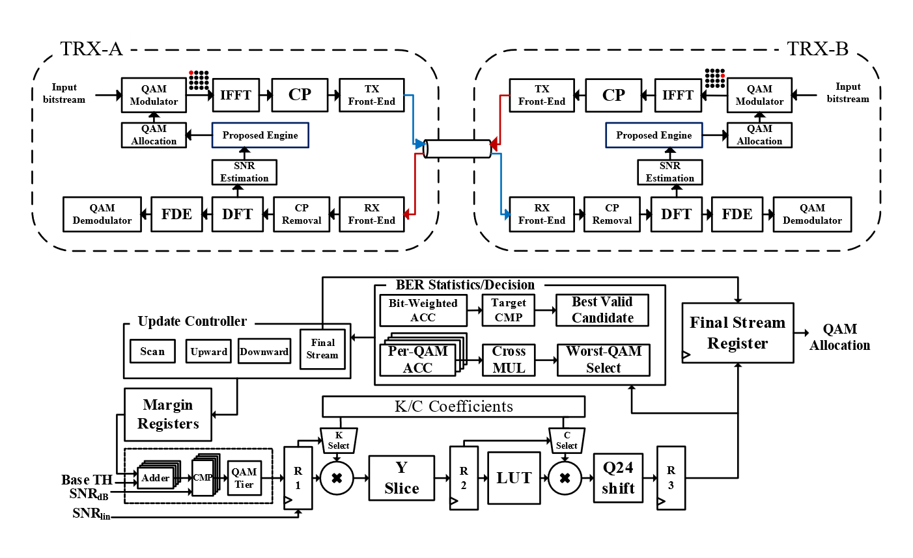
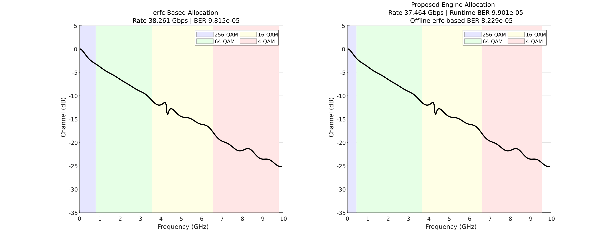
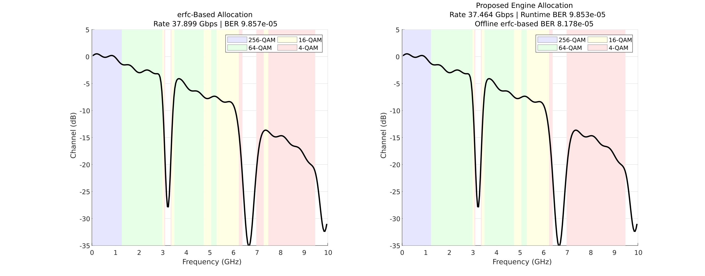

양방향 이산 다중 반송파 유선 트랜시버를 위한 보수적 비트 오류율 추정 기반 저복잡도 비트 로딩 엔진

저자 A, 저자 B, 지도교수 C

1 항공전자정보공학부, 한국항공대학교, 고양, 대한민국

Email: \[교신저자의 기관 이메일\]

*Running title:* Conservative Bit-Loading Engine

고속 유선 링크의 주파수 선택적 손실을 효율적으로 이용하기 위해, 본 논문은 이산 다중 반송파(DMT) training/retraining 과정에서 신호 대 잡음비(SNR) profile로 tone별 직교 진폭 변조(QAM) allocation을 생성하는 PHY 내부 비트 오류율(BER) 기반 bit-loading engine을 제안한다. QAM별 coefficient 탐색은 Q16/Q24 RTL 양자화와 truncation을 반영하며, fixed-point estimator가 설계 SNR 구간에서 채택한 erfc 기반 BER 기준보다 작아지지 않도록 한다. Engine은 32-entry exponential look-up table, Q24 BER 연산, 전송 bit 가중 aggregation, divider-free group comparison 및 QAM별 margin refinement를 사용한다. 두 channel profile에서 erfc 기반 dynamic-programming 기준 대비 net-rate loss는 최대 2.08%였고, 채택한 BER식을 부동소수점으로 재평가한 최종 allocation은 모두 10⁻⁴ target을 만족하였다. 동일 implementation flow에서 제안 engine은 unbiased piecewise-Chebyshev RTL baseline 대비 total cell area와 total power를 각각 41.0%와 26.6% 줄였으며, 두 구현 모두 100 MHz에서 1 ms 이내에 allocation을 완료하였다.

*주요어:* 적응형 비트 로딩; 비트 오류율 추정; 이산 다중 반송파; 고정소수점 연산; 룩업 테이블; 유선 트랜시버

*Introduction:* 고속 chip-to-chip 및 backplane 유선 링크에서는 data rate가 증가할수록 고주파 channel loss와 equalisation 부담이 커진다. PAM은 symbol당 bit 수가 고정되므로 심한 frequency selectivity나 notch가 있는 channel의 SNR 분포를 효율적으로 활용하기 어렵다. 반면 이산 다중 반송파는 wideband channel을 다수의 subcarrier로 분할하고 tone별 QAM order를 조절하므로 주파수 선택적 channel에 적합하다 \[1\].

Bit loading 자체는 잘 알려져 있지만, training 또는 retraining 때 이를 작은 PHY 내부 digital controller로 빠르게 수행하는 것은 별도의 구현 문제이다. BER-informed bit/power profile adjustment는 subchannel error distribution을 이용한 성능 향상을 보였지만 waveform generation, received-data processing 및 profile 계산이 MATLAB에서 수행되었다 \[2\]. 본 연구는 normal data transmission 중의 continuous adaptation이 아니라, SNR profile이 주어진 뒤 수백 μs 안에 새로운 QAM map을 생성하는 synthesizable on-PHY engine을 대상으로 한다.

Matched endpoint에서 양방향 channel quality가 충분히 유사하다는 적용 조건 아래 local-RX-to-local-TX 구조를 고려한다. RX-A가 관측한 B→A SNR profile로 local TX-A의 A→B map을 계산하고 반대 방향도 동일하게 동작한다. 양방향에 동일한 hardware를 사용하는 유사 개념은 VLC rate-selection 연구에서도 보고되었다 \[3\]. 이는 모든 wireline link의 reciprocity를 일반적으로 가정하는 것은 아니다. 전체 구조는 Fig. 1에 나타냈다.

Fig. 1 제안하는 local-RX-to-local-TX 양방향 이산 다중 반송파 구조와 conservative-Q24 on-PHY bit-loading engine. erfc 기반 DP oracle은 offline reference로만 사용되며 RTL datapath에는 포함되지 않는다.

*Proposed engine:* 평가 시스템은 20 Gsample/s, 512-point FFT/IFFT, 40-sample cyclic prefix, 255개 active positive-frequency tone과 4/16/64/256-QAM을 사용한다. Engine 입력은 training/retraining에서 얻어진 Q16 per-tone SNR이며 QAM별 base threshold는 6, 12, 18, 24 dB이다. 성능 기준은 동일한 Q16 SNR과 candidate set {unused, 4-QAM, 16-QAM, 64-QAM, 256-QAM}에서 bit-weighted BER≤10⁻⁴를 만족하면서 total loaded bits를 최대화하는 offline dynamic-programming(DP) oracle이다. 이 oracle은 채택한 erfc 기반 BER식을 직접 계산한다. Gray-coded square M-QAM에 널리 쓰이는 다음 high-SNR BER 근사식을 채택한다 \[4\]:

$P_{b}^{ref}(M,\gamma) = \frac{2}{\log_{2}M}\left( 1 - \frac{1}{\sqrt{M}} \right)erfc\left( \sqrt{\frac{3\gamma}{2(M - 1)}} \right)$ (1)

여기서 erfc(·)는 complementary error function, M은 QAM order, γ는 linear per-tone SNR이다. 식 (1)을 직접 계산하는 대신 engine은 식 (2)의 base-2 exponential 형태를 고정소수점으로 구현한다.

${\widehat{P}}_{b}(M,\gamma) = C_{M}2^{- K_{M}\gamma}$ (2)

*KM*, *CM*과 SNR은 Q16으로 양자화한다. Y=*KM*γ의 fractional 5 bit로 32-entry Q16 LUT를 읽고 integer part를 shift 값으로 분리한다. *CM*×LUT 곱은 Q24 BER base가 되며, 이를 Y의 정수부만큼 right shift하여 최종 tone BER을 생성한다. R1-R3는 tier, SNR, carrier index 및 valid를 각 stage에 정렬하므로 pipeline fill 이후 매 clock마다 한 tone을 받아들인다. *KM*과 *CM*은 각 QAM의 base threshold부터 기준 BER이 2⁻²⁰에 도달하는 QAM별 구간 *DM*에서 식 (3)의 one-sided 조건이 성립하도록 선택하였다.

${\widehat{P}}_{b}^{Q24}(M,\gamma) \geq P_{b}^{ref}(M,\gamma),\quad\quad\gamma \in \mathcal{D}_{M}$ (3)

계수 생성 시 각 QAM의 65,536개 unsigned Q16 K 후보를 조사하였다. 각 K에 대해 식 (3)을 만족하는 최소 C를 구하고, estimator-to-reference-BER ratio의 최댓값이 가장 작은 pair를 선택하였다. \[4-QAM, 16-QAM, 64-QAM, 256-QAM\] 순서의 Q16 coefficient는 K=\[50734, 10213, 2436, 602\], C=\[12756, 10206, 8057, 6506\]이다. 예를 들어 64-QAM 검증 구간에서 Q24 estimator-to-reference-BER ratio는 1.00005~1.23031이며 underestimation은 발생하지 않는다. γ가 매우 커서 부동소수점 기준 BER이 2⁻²⁰보다 작고 Q24 result가 zero로 양자화될 수 있는 영역은 coefficient를 불필요하게 키우지 않고 global residual guard로 처리한다.

QAM별 tone당 bit 수가 다르므로 controller의 link BER은 단순 tone average가 아니라 bit-weighted BER로 계산한다.

$P_{b,total} = \frac{\sum_{k}^{}b_{k}P_{b,k}}{\sum_{k}^{}b_{k}}$ (4)

목표 BER은 *Pb,target*=10⁻⁴이며, low-BER quantisation tail에서 가능한 최대 누락량 2⁻²⁰을 미리 예약하여 runtime 통과 기준을 식 (5)로 둔다. RTL에서는 분모로 나누지 않고 weighted-error sum과 guarded target×total-bit 수를 cross multiplication으로 비교한다.

${\widehat{P}}_{b,total} \leq P_{b,target} - 2^{- 20} = 9.90463 \times 10^{- 5}$ (5)

Engine FSM은 scan, BER 판정, margin update 및 output의 순서로 동작한다.

${Th}_{M,final} = T_{M} + \mu_{M}$ (6)

각 scan에서 tone별 SNR이 base threshold *TM*과 현재 QAM-specific margin *μM*의 합을 만족하는 가장 높은 QAM을 할당한다. Guarded BER target을 만족하지 못하면 네 QAM group의 error sum과 count로 평균 estimated BER을 비교하고 worst tier의 *μM*을 6554/65536=0.100006 dB 증가시킨다. 나눗셈은 sequential cross multiplication으로 피한다. 최초 valid allocation을 찾은 뒤에는 각 QAM margin을 한 step씩 낮추어 다시 scan하고, guarded target을 통과한 후보 중 loaded-bit 수가 가장 큰 allocation을 유지한다. 더 이상 유효한 감소가 없으면 scan을 멈추고 최종 allocation을 출력한다. Fig. 2는 채택한 erfc 기반 기준, one-sided Q24 근사 및 대응 allocation을 비교한다.

 

Fig. 2 4/16/64/256-QAM에 대한 채택한 erfc 기반 기준과 one-sided Q24 근사(top), 그리고 Channel-25와 two-null profile의 erfc 기반 allocation 및 proposed allocation(bottom). 각 curve는 base threshold부터 기준 BER=2⁻²⁰까지의 QAM별 검증 구간을 나타낸다.

*Results and discussion:* Pole-residue 기반 Channel-25와 deterministic two-null profile을 평가하였다. Offline erfc 기반 DP reference는 동일한 Q16 SNR과 candidate set을 사용하며 synthesizable baseline이 아니다. 이 reference 대비 rate는 Channel-25에서 38.261→37.464 Gb/s, two-null에서 37.899→37.464 Gb/s로 변했으며 rate loss는 각각 2.08%와 1.15%이다.

제안 engine의 runtime conservative-Q24 BER은 두 profile에서 각각 9.901×10⁻⁵와 9.853×10⁻⁵이고, 동일 final allocation을 식 (1)로 부동소수점 재평가한 BER은 각각 8.229×10⁻⁵와 8.178×10⁻⁵이다. Runtime estimator가 target에 가깝게 allocation을 중단해도 두 기준 BER은 모두 10⁻⁴ 이하이며, 이는 one-sided coefficient selection과 2⁻²⁰ residual guard의 의도와 일치한다. erfc 기반 DP reference는 채택한 model과 candidate set 아래의 software-only global optimum이므로, rate gap은 hardware-oriented estimator와 margin-search/refinement controller의 성능 cost를 나타낸다.

구현 비용 비교에는 동일 controller, BER target, Q16/Q24 interface 및 1 tone/clock initiation interval을 갖는 unbiased piecewise-Chebyshev RTL baseline을 사용하였다. Offline erfc 기반 DP reference와 달리 이는 synthesizable hardware baseline이며 proposed와 동일한 allocation controller를 포함한다.

Unbiased Chebyshev baseline은 h(z)=erfc(√z), z∈\[1.25,12.25)를 폭 0.25의 44개 구간으로 나누고 각 구간을 4차 polynomial로 근사한다. Q30 coefficient와 four-stage Horner pipeline을 사용하며 datapath latency는 7 cycles이다. 표현 가능한 720,896개 Q16 z 값 중 363,139개 case(50.37%)에서 직접 계산한 erfc 기반 기준보다 작으므로 one-sided 보장은 없다. 다만 target 중심 구간 5×10⁻⁵≤BER≤2×10⁻⁴에서 최대 상대 underestimation은 0.0634%에 불과하다.

| Metric                       | Chebyshev RTL | Proposed  |
|------------------------------|---------------|-----------|
| Total cell area (tool units) | 50,813.64     | 29,958.48 |
| Total power (mW)             | 2.5048        | 1.8381    |
| Channel-25 latency (μs)      | 511.09        | 565.55    |
| Two-null latency (μs)        | 581.03        | 578.53    |

Table 1 Tool-reported area, total power 및 end-to-end latency 비교.

동일 implementation flow에서 unbiased piecewise-Chebyshev baseline과 proposed engine의 total cell area는 각각 50,813.64와 29,958.48 tool units로, proposed가 41.0% 작았다. Total power는 2.5048에서 1.8381 mW로 26.6% 감소하였다. Table 1은 이 결과와 end-to-end latency를 요약한다.

*투고 전 보완할 구현 조건:* \[표준셀 library/process와 PVT corner; synthesis·power-analysis tool/version; switching-activity 산정법; 외부 memory 포함 여부; physical area 단위.\]

100 MHz Channel-25에서 Chebyshev baseline과 proposed engine의 latency는 각각 511.09와 565.55 μs이다. Baseline은 186회, proposed는 210회의 scan을 수행하므로 7-cycle과 3-cycle datapath 차이보다 scan 수 차이가 크게 작용하여 baseline이 54.46 μs 빠르다. Two-null에서는 scan 수가 212회와 215회로 유사하고 proposed가 2.50 μs 빠르다. 따라서 end-to-end latency는 BER datapath 깊이뿐 아니라 estimator가 유도하는 margin-search/refinement scan 수에도 좌우되며, 두 구현 모두 두 profile에서 1 ms 제약을 만족한다.

*Conclusion:* 본 논문은 이산 다중 반송파 wireline transceiver의 training/retraining을 위한 conservative fixed-point BER-aware bit-loading engine을 제안하였다. QAM별 K,C pair는 설계 구간에서 채택한 erfc 기반 기준을 underestimate하지 않도록 선택되며, 2⁻²⁰ residual guard, bit-weighted BER, divider-free group selection 및 two-phase margin search를 결합하였다. 두 channel profile에서 erfc 기반 DP reference 대비 rate loss를 2.08% 이하로 제한하면서 부동소수점 BER target을 만족하였다. Unbiased piecewise-Chebyshev RTL baseline 대비 total cell area와 total power를 각각 41.0%와 26.6% 줄였으며, 두 구현 모두 100 MHz에서 1 ms 이내의 latency를 유지하였다.

*감사의 글:* \[모든 연구비와 지원 내역을 기재하거나 ‘없음’으로 표시.\]

*데이터 이용 가능성:* \[해당 Wiley data-availability 표준문구를 기재.\]

*이해상충:* \[이해상충을 기재하거나 ‘없음’으로 표시.\]

*AI 사용 공개:* OpenAI ChatGPT를 언어 교정, 용어 점검 및 원고 형식 정리에 사용하였다. 저자들은 최종 내용을 검토했으며 그에 대한 모든 책임을 진다.

References

1\. G. Kim, “Design Space Exploration of Single-Lane OFDM-Based Serial Links for High-Speed Wireline Communications,” IEEE Open Journal of Circuits and Systems 3 (2022): 134–146, https://doi.org/10.1109/OJCAS.2022.3189550.

2\. B. Vatankhahghadim, B. Radi, M. Hossain, and A. C. Carusone, “Spectrally Efficient DMT Operation With BER-Informed Dynamic Bit and Power Loading,” IEEE Access 10 (2022): 122061–122076, https://doi.org/10.1109/ACCESS.2022.3222757.

3\. J. Zhang, X. Zhang, and G. Wu, “Dancing with Light: Predictive In-Frame Rate Selection for Visible Light Networks,” in Proceedings of IEEE INFOCOM 2015 (2015), 2434–2442, https://doi.org/10.1109/INFOCOM.2015.7218632.

4\. K. Cho and D. Yoon, “On the General BER Expression of One- and Two-Dimensional Amplitude Modulations,” IEEE Transactions on Communications 50, no. 7 (2002): 1074–1080, https://doi.org/10.1109/TCOMM.2002.800818.
